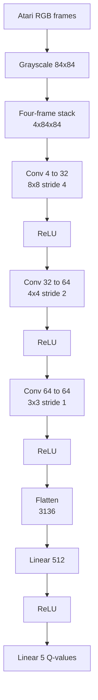

# Deep Q-learning for Atari Pac-Man

This project implements a Deep Q-Network (DQN) from scratch in PyTorch and Gymnasium. The selected game is `ALE/Pacman-v5`. Group members: Hamed, Andrew, Heroine Mutumwinka, and Mahamat Bakhit.

## Repository Structure

```text
.
├── train.py                         # Train a DQN and save experiment outputs
├── evaluate.py                      # Evaluate saved model checkpoints
├── play.py                          # Play Pac-Man with a trained model
├── model.py                         # DQN neural network
├── buffer.py                        # Experience replay buffer
├── wrappers.py                      # Atari preprocessing and frame stacking
├── aggregate_results.py             # Summarize experiment metrics
├── make_reports.py                  # Generate experiment reports
├── plot_training.py                 # Plot training metrics
├── pyproject.toml                   # Project metadata and dependencies
├── uv.lock                          # Locked dependency versions
├── final_model/                     # Selected trained checkpoint
├── plots/                           # Training and experiment plots
├── videos/                          # Gameplay recordings
├── andrew/                          # Andrew's experiment results
├── hamed/                           # Hamed's experiment results
├── heroine/                         # Heroine's experiment results
├── mahamat_bakhit/                  # Mahamat Bakhit's experiment results
└── team_experiments_results/        # Combined experiment reports
```

## Setup

Install [uv](https://docs.astral.sh/uv/getting-started/installation/), then from the repository root run:

```bash
uv sync
```

`pyproject.toml` and `uv.lock` specify the environment.

## Model Architecture



`wrappers.py` applies frame skip 4, resizing, and frame stacking. `model.py` defines the CNN. `train.py` keeps an online network and a periodically copied target network. It explores with linear epsilon decay, stores transitions in `buffer.py`, samples random batches, and minimizes Huber loss between the chosen Q-value and `clipped_reward + gamma × max(target Q(next_state))` for nonterminal transitions. Adam updates the online network every four agent steps after 10,000 warm-up steps. Raw episode rewards, lengths, and cumulative steps are logged in each `metrics.csv`.

## Gameplay Video

[](https://youtube.com/shorts/GWpoid5EPzc)

## Ten experiments per member

Each of the four members completed ten distinct hyperparameter combinations. For example, from the repository root:

```bash
./run_experiments_heroine.sh 1
./run_experiments_heroine.sh all
```

Full guide is avilable at [team_experiment_guide.md](./team_experiment_guide.md)

## Evaluation, plots and gameplay

Evaluate saved checkpoints under greedy actions and identical seeds:

```bash
uv run python evaluate.py --episodes 5 --output evaluation_results.csv
```

All 40 saved checkpoints were evaluated with greedy actions on the same five seeds (1000–1004); results are in `evaluation_results.csv`. The highest mean reward was **Heroine experiment 8: 140.4**, followed by Heroine experiment 6: 100.2. Heroine experiment 8 is the final selected checkpoint, copied to the final_model folder as `dqn_model.pth`. Its reward, episode-length, and step plot is `plots/heroine_exp08_training.png`. Our evaluation uses a finite set of seeds, so scores are estimates, not guarantees. To regenerate it:

```bash
uv run python plot_training.py heroine/exp_08/metrics.csv --output plots/best_training.png
```

Display the best selected model:

```bash
uv run python play.py --model final_model/dqn_model.pth
```

Record a gameplay video:

```bash
uv run python play.py --model dqn_model.pth --video-dir videos --headless
```

The [gameplay demonstration](videos/rl-video-episode-0.mp4) was recorded from seed 2000 with greedy actions; the episode scored 202 over 906 agent steps. The video uses the final selected checkpoint.
