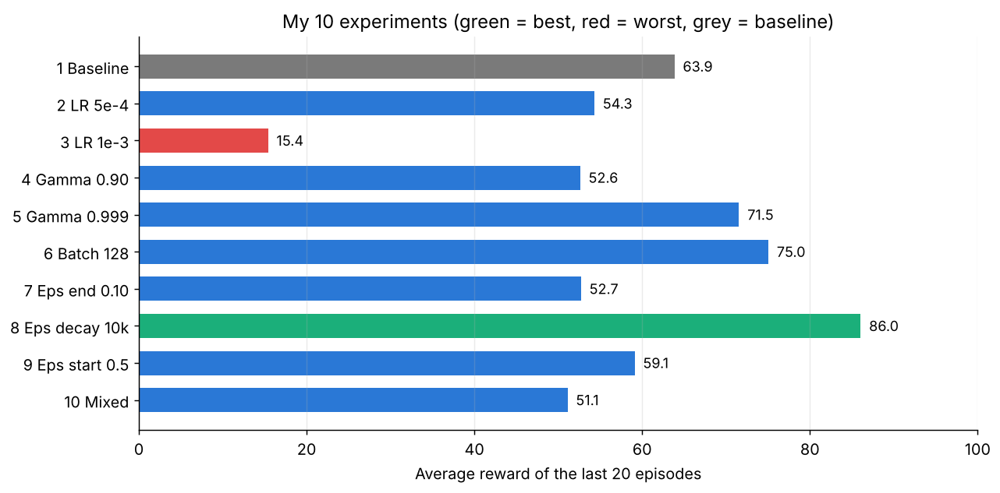
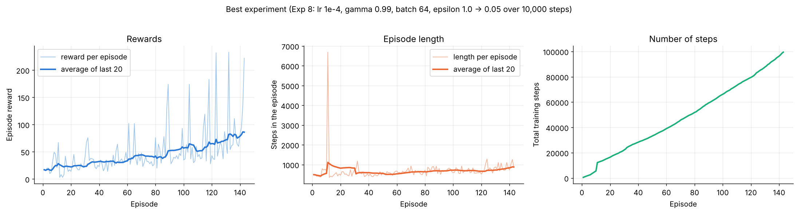

# Hyperparameter Experiments – Heroine Mutumwinka

**Environment:** `ALE/Pacman-v5` · **Training:** 100,000 steps per experiment, shared `train.py` (same CNN, replay buffer of 100,000, target network updated every 1,000 steps, seed 42).

**How I chose my experiments:** Experiment 1 is my baseline. It combines the two best settings from Hamed's experiments (batch size 64 and epsilon end 0.05). Experiments 2–9 change **only one** hyperparameter from my baseline, so I can see the effect of that one value. Experiment 10 changes several values at once. None of my 10 combinations repeats Hamed's or Andrew's.

**How I measured performance:** the average reward of the **last 20 episodes** of training (higher is better). The rewards come from training episodes, where the agent still makes some random moves (epsilon), so single episodes are noisy.

## Experiment table

**Member Name: Heroine Mutumwinka**

| Experiment | Learning rate | Gamma | Batch size | Epsilon start | Epsilon end | Epsilon decay | Observed behaviour |
|---|---|---|---|---|---|---|---|
| 1 | 1e-4 | 0.99 | 64 | 1.0 | 0.05 | 50,000 | **Baseline.** Steady learning. Average of the last 20 episodes was 63.85 (max 341). This is already higher than Hamed's best (47.90) and Andrew's best (61.00), so combining batch 64 with epsilon end 0.05 worked well. |
| 2 | 5e-4 | 0.99 | 64 | 1.0 | 0.05 | 50,000 | **Higher learning rate was worse** (54.30). Learning improved more slowly and the loss was higher (0.067 vs about 0.04 in most runs), so the updates were less stable. The max of 339 happened very early (step 20,007, epsilon 0.62), so it was a lucky random episode, not good learning. |
| 3 | 1e-3 | 0.99 | 64 | 1.0 | 0.05 | 50,000 | **Worst experiment** (15.40, max 87). The learning rate was too big, so the agent got *worse* over time: 21.2 average in the first half and only 14.2 in the second half. It had the most episodes (227) and the shortest games (about 450 steps), which means it died quickly. Too big steps break the Q-values. |
| 4 | 1e-4 | 0.90 | 64 | 1.0 | 0.05 | 50,000 | **Low gamma (short-sighted) was worse** (52.60). The agent only cares about rewards in the next few steps, so it does not plan ahead (for example, to avoid ghosts). One very high episode (448, my highest single score) shows it can get lucky, but the average stayed low. The last episode was still running when training stopped, so the last logged step is 87,383. |
| 5 | 1e-4 | 0.999 | 64 | 1.0 | 0.05 | 50,000 | **High gamma (far-sighted) was better** than the baseline (71.55). Planning further ahead helps in Pac-Man. But it was very unstable (standard deviation 73 in the last 20 episodes), because far-future values make the targets noisier. |
| 6 | 1e-4 | 0.99 | 128 | 1.0 | 0.05 | 50,000 | **Bigger batch was better** (75.05, max 346). Averaging over more experiences gives smoother updates. It had one of the best second halves of training (72.3) and improved steadily. Andrew also found that a bigger batch (96) was his best. |
| 7 | 1e-4 | 0.99 | 64 | 1.0 | 0.10 | 50,000 | **More random moves at the end was worse** (52.70, max 169). With epsilon 0.10, the agent still takes a random action 10 % of the time, so it often makes bad moves even after it has learned. One very long episode (about 15,600 steps) happened in the middle of training. |
| 8 | 1e-4 | 0.99 | 64 | 1.0 | 0.05 | 10,000 | **Best experiment** (86.05). Epsilon reached its minimum after only 10,000 steps, so the agent used what it learned for 90 % of the training. Its games were the longest (about 880 steps in the last 20 episodes), so it survived longer and ate more. The reward kept rising until the end. |
| 9 | 1e-4 | 0.99 | 64 | 0.5 | 0.05 | 50,000 | **Starting with less exploration made little difference** (59.10, close to the baseline). It scored better at the start (32.9 in the first half, one of the highest) because it made fewer random moves, but it ended slightly below the baseline. |
| 10 | 2.5e-4 | 0.98 | 128 | 1.0 | 0.02 | 80,000 | **Mixed combination was worse** (51.10, max 152). Exploration only finished at step 80,000, so there were only 20,000 steps left to use what it learned. It also had the highest loss (0.086), probably because of the higher learning rate. |

## Summary of results

| Exp | What changed from the baseline | Avg reward (last 20) | Max reward | Episodes |
|---|---|---|---|---|
| 1 | – (baseline) | 63.85 | 341 | 173 |
| 2 | Learning rate 5e-4 | 54.30 | 339 | 176 |
| 3 | Learning rate 1e-3 | **15.40 (worst)** | 87 | 227 |
| 4 | Gamma 0.90 | 52.60 | 448 | 162 |
| 5 | Gamma 0.999 | 71.55 | 333 | 177 |
| 6 | Batch size 128 | 75.05 | 346 | 174 |
| 7 | Epsilon end 0.10 | 52.70 | 169 | 151 |
| 8 | Epsilon decay 10,000 | **86.05 (best)** | 233 | 143 |
| 9 | Epsilon start 0.5 | 59.10 | 180 | 159 |
| 10 | Several changes | 51.10 | 152 | 192 |

## What I learned about each hyperparameter

- **Learning rate:** the higher the learning rate, the worse the agent (63.85 → 54.30 → 15.40). 1e-4 was the best value I tested. A learning rate of 1e-3 makes the updates so big that the agent unlearns.
- **Gamma:** higher gamma was better (0.90: 52.60, 0.99: 63.85, 0.999: 71.55). Pac-Man rewards planning ahead, but a very high gamma also makes training less stable.
- **Batch size:** 128 was better than 64. Bigger batches give smoother, more reliable updates.
- **Epsilon decay:** the biggest effect of all. With only 100,000 steps, stopping exploration early (10,000 steps) gave the agent much more time to use and improve what it learned.
- **Epsilon end:** keeping more randomness at the end (0.10) lowered the score.
- **Epsilon start:** starting at 0.5 instead of 1.0 changed little.

## Best and worst configuration

- **Best: Experiment 8** – lr 1e-4, gamma 0.99, batch 64, epsilon 1.0 → 0.05 over 10,000 steps. Average reward 86.05, and still improving at the end.
- **Worst: Experiment 3** – learning rate 1e-3. Average reward 15.40, and the agent got worse during training.

## My final configuration and why

I choose **Experiment 8** as my final configuration, because it had the highest average reward and the reward was still going up at the end of training. My results also suggest that a bigger batch (128) and a higher gamma (0.999) help, so a good next experiment would combine them with the fast epsilon decay of Experiment 8.

## Training performance of my best experiment (Experiment 8)

The brief asks for episode length, number of steps and rewards for the best experiment:

- **Rewards:** the average of the last 20 episodes rose from about 17 at the start to 86 at the end.
- **Episode length:** the games got longer over time (from about 500 to about 880 steps), so the agent survived longer. One very long episode (about 6,700 steps) happened early in training, while the agent was still exploring a lot.
- **Number of steps:** 143 episodes in 100,000 training steps.

## Limitations

- Each experiment was run **only once** (one random seed). Rewards change a lot from one game to the next (standard deviation of about 9–73 in the last 20 episodes), so small differences between experiments (for example 52.6 vs 52.7) may just be luck.
- The rewards come from **training** episodes, where the agent still makes random moves, not from a separate test with greedy play.
- 100,000 steps is a short training time for Pac-Man, so all agents are still beginners.
